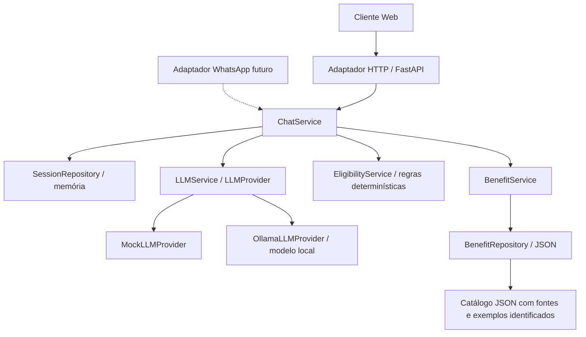

# Simplifica Social

Guia rápido: [principais comandos de execução, acesso pela mesma rede, testes e Docker](COMANDOS.md).

Back-end acadêmico que ajuda cidadãos a descrever sua situação e descobrir possíveis benefícios relacionados, sem precisar conhecer previamente seus nomes. O catálogo contém três exemplos fictícios e uma triagem inicial simplificada do Bolsa Família, com fonte oficial. A conversa pode interpretar mensagens com um modelo local pelo Ollama (`OllamaLLMProvider`) ou com o extrator de padrões (`MockLLMProvider`).

O resultado é uma comparação com critérios cadastrados. Mesmo `COMPATIVEL` **não confirma direito a benefício**. A triagem do Bolsa Família verifica renda por pessoa e inscrição no Cadastro Único; outras condições e a seleção precisam ser confirmadas oficialmente. Ela não decide permanência no programa nem aplica a Regra de Proteção.

## Arquitetura



As rotas cuidam do transporte HTTP. O `ChatService` combina extração, perfil acumulado, análise e resposta, sem depender de FastAPI. O motor decide os resultados usando operadores permitidos, nunca `eval` ou uma decisão da IA. O provedor recebe cópias dos resultados para gerar o texto.

Foram acrescentados `session_repository.py`, rotas próprias para sessões e benefícios e testes específicos. Isso separa o armazenamento do fluxo de conversa e permite substituir JSON/memória por banco de dados implementando os mesmos contratos (`Protocol`). Não há front-end, integração real com WhatsApp, RAG ou banco vetorial.

## Estrutura

```text
simplifica-social/
├── app/
│   ├── __init__.py
│   ├── main.py
│   ├── api/
│   │   ├── __init__.py
│   │   ├── dependencies.py
│   │   └── routes/
│   │       ├── __init__.py
│   │       ├── health.py
│   │       ├── chat.py
│   │       ├── sessions.py
│   │       └── benefits.py
│   ├── core/
│   │   ├── __init__.py
│   │   ├── config.py
│   │   └── exceptions.py
│   ├── models/
│   │   ├── __init__.py
│   │   ├── citizen.py
│   │   ├── benefit.py
│   │   └── chat.py
│   ├── repositories/
│   │   ├── __init__.py
│   │   ├── benefit_repository.py
│   │   └── session_repository.py
│   ├── services/
│   │   ├── __init__.py
│   │   ├── benefit_service.py
│   │   ├── eligibility_service.py
│   │   ├── llm_service.py
│   │   └── chat_service.py
│   └── data/
│       └── benefits.json
├── tests/
│   ├── conftest.py
│   ├── test_health.py
│   ├── test_sessions.py
│   ├── test_chat.py
│   ├── test_benefits.py
│   ├── test_eligibility.py
│   ├── test_per_capita.py
│   └── test_llm.py
├── .dockerignore
├── .env.example
├── .gitignore
├── Dockerfile
├── docker-compose.yml
├── pyproject.toml
├── requirements.txt
└── README.md
```

## Tecnologias e instalação

Python 3.12+, FastAPI, Pydantic 2, Uvicorn, python-dotenv, pytest e HTTPX (cliente de testes). Docker usa Python 3.12. Git ignora ambientes virtuais, caches e arquivos `.env`.

Na raiz do projeto, usando PowerShell:

```powershell
python --version
python -m venv .venv
.\.venv\Scripts\python.exe -m pip install -r requirements.txt
Copy-Item .env.example .env
.\.venv\Scripts\python.exe -m uvicorn app.main:app --reload --host 127.0.0.1 --port 8000 --no-access-log
```

Não é necessário ativar o ambiente virtual. Copie `.env.example` apenas se ainda não tiver um `.env`.

Em Linux/macOS:

```bash
python3 -m venv .venv
.venv/bin/python -m pip install -r requirements.txt
cp .env.example .env
.venv/bin/python -m uvicorn app.main:app --reload --host 127.0.0.1 --port 8000 --no-access-log
```

Acesse <http://localhost:8000> (redireciona ao Swagger), <http://localhost:8000/docs> ou <http://localhost:8000/health>.

Use **um único worker** enquanto o armazenamento for em memória. Reiniciar a aplicação, inclusive pelo `--reload`, apaga as sessões. Processos ou réplicas diferentes não compartilham dados.

## Usar Ollama localmente

`pip install ollama` instala o cliente Python. Também é necessário instalar e abrir
o [aplicativo Ollama para Windows](https://ollama.com/download/windows), que executa os modelos.
Depois da instalação, abra um novo terminal PowerShell e execute:

```powershell
ollama pull qwen3:4b
ollama list
.\.venv\Scripts\python.exe -m pip install -r requirements.txt
```

O modelo inicial é [Qwen3 4B](https://ollama.com/library/qwen3:4b), multilíngue e com
download de aproximadamente 2,5 GB. Ajuste `OLLAMA_MODEL` para usar outro
modelo local instalado. O desempenho e a qualidade da extração dependem do modelo e do computador.

Configure o `.env` na raiz (ou copie `.env.example` se ele ainda não existir):

```dotenv
LLM_PROVIDER=ollama
OLLAMA_HOST=http://localhost:11434
OLLAMA_MODEL=qwen3:4b
OLLAMA_TIMEOUT_SECONDS=120
```

Inicie a API:

```powershell
.\.venv\Scripts\python.exe -m uvicorn app.main:app --reload --host 127.0.0.1 --port 8000 --no-access-log
```

Use a conversa em <http://localhost:8000/docs> conforme os exemplos abaixo. Se o
servidor Ollama não estiver ativo, abra o aplicativo ou execute `ollama serve` em
outro terminal. Não é necessário executar `ollama run` antes de usar a API.

O provedor envia a mensagem atual, o perfil acumulado e o campo da pergunta pendente
ao Ollama. A [saída estruturada](https://docs.ollama.com/capabilities/structured-outputs)
é validada pelo Pydantic antes de atualizar a sessão. As regras de elegibilidade,
o cálculo de renda por pessoa e a composição da resposta continuam determinísticos.
O cliente envia `think=False` para desativar a etapa de raciocínio do Qwen3 nesta
tarefa de extração. Ao trocar de modelo, verifique se ele aceita esse parâmetro.
O modelo interpreta os dados, mas ainda pode cometer erros de interpretação; revise
o perfil retornado. A estrutura JSON não garante a veracidade dos valores.

Falhas de conexão, timeout ou modelo ausente retornam `503` com orientação; JSON
inválido retorna `400`. Nessas falhas, a sessão é preservada. `/health` verifica a API,
sem verificar a disponibilidade do modelo. Para usar o extrator sem modelo, defina
`LLM_PROVIDER=mock` e reinicie a API. Sem configuração, o padrão também é `mock`.

## Docker

Inicie o Docker Desktop com o mecanismo de contêineres Linux ativo e execute:

```bash
docker compose up --build
```

O Compose publica a API somente em `127.0.0.1:8000`, executa um worker e inclui verificação de saúde. O processo no contêiner usa um usuário sem privilégios de root. Não é obrigatório criar `.env` para usar os valores padrão do Compose.

Com `LLM_PROVIDER=ollama`, o Compose conecta ao Ollama da máquina hospedeira por
`http://host.docker.internal:11434` (independentemente do `OLLAMA_HOST` do `.env`,
que serve à execução local). O aplicativo e o modelo devem estar instalados no host.
O servidor precisa aceitar conexões vindas do contêiner; conforme a configuração
de rede do Docker/Ollama, pode ser necessário ajustar a interface de escuta do servidor.

```bash
docker compose config --quiet
docker compose down
```

Não há volumes de sessões: parar/recriar o processo perde o estado. Alterações no catálogo exigem reconstruir a imagem. `BENEFITS_PATH` é uma opção da execução local; no Compose o catálogo está incluído na imagem.

## Configuração

O arquivo `.env` é lido da raiz do projeto; variáveis do ambiente têm precedência. Não existem chaves de fornecedor nesta etapa.

| Variável | Padrão | Finalidade |
| --- | --- | --- |
| `APP_NAME` | `Simplifica Social` | Título da API |
| `LLM_PROVIDER` | `mock` | `mock` ou `ollama`; `.env.example` seleciona `ollama` |
| `OLLAMA_HOST` | `http://localhost:11434` | Endereço do servidor Ollama na execução local |
| `OLLAMA_MODEL` | `qwen3:4b` | Modelo instalado no Ollama |
| `OLLAMA_TIMEOUT_SECONDS` | `120` | Tempo máximo de extração |
| `SESSION_TTL_SECONDS` | `3600` | Expiração por inatividade |
| `MAX_SESSIONS` | `1000` | Limite de sessões simultâneas |
| `MAX_MESSAGES_PER_SESSION` | `100` | Máximo de mensagens guardadas por sessão, incluindo respostas |
| `ENABLE_SESSION_INSPECTION` | `true` | Permite consultar sessões para desenvolvimento |
| `BENEFITS_PATH` | `app/data/benefits.json` | Caminho absoluto ou relativo à raiz do projeto |

## Endpoints

| Método | Caminho | Resultado |
| --- | --- | --- |
| GET | `/health` | `200`, `{"status":"ok"}` |
| POST | `/api/sessions` | `201`, cria sessão; corpo `{}` assume `WEB` |
| GET | `/api/sessions/{session_id}` | `200`, perfil, histórico e pergunta pendente |
| POST | `/api/chat` | `200`, resposta e análises estruturadas |
| GET | `/api/benefits` | `200`, catálogo completo |
| GET | `/api/benefits/{codigo}` | `200`, um benefício |
| GET | `/docs` | Swagger interativo |
| GET | `/openapi.json` | Contrato OpenAPI |

Sessão ausente/expirada e benefício inexistente retornam `404`; canal divergente retorna `409`; entrada HTTP inválida retorna `422`; dados extraídos inválidos retornam `400`; limite de sessões retorna `503`. Uma falha de extração não altera a sessão. Mensagens devem ter de 1 a 2.000 caracteres após remover espaços nas extremidades.

## Exemplo de conversa

No Swagger, crie uma sessão com `POST /api/sessions`:

```json
{"channel": "WEB"}
```

Copie o `session_id` retornado e use em `POST /api/chat`:

```json
{
  "session_id": "SUBSTITUA-PELO-UUID-RETORNADO",
  "channel": "WEB",
  "message": "Tenho 67 anos e moro sozinho"
}
```

A resposta contém `profile.idade = 67`, `profile.quantidade_pessoas_familia = 1`, o exemplo Acolhimento Sênior como `POSSIVEL` e uma pergunta sobre renda familiar. Continue na mesma sessão:

1. Envie `"R$ 1.800,50"`: o perfil recebe a renda e a próxima pergunta é sobre Cadastro Único.
2. Envie `"Sim"`: o exemplo Sênior fica `COMPATIVEL`, acompanhado de aviso de que isso não confirma direito a benefício.
3. Envie `"Corrigindo, tenho 60 anos"`: a idade é atualizada e o exemplo Sênior fica `INCOMPATIVEL`.

As análises incluem critérios atendidos, não atendidos, pendentes, perguntas e próximos passos. `possible_benefits` contém apenas `COMPATIVEL` e `POSSIVEL`; `analyses` contém todos os resultados, inclusive incompatíveis e insuficientes. `missing_information` e `questions` são deduplicados por campo, considerando exemplos ainda não incompatíveis. Exemplos com critérios já atendidos recebem prioridade. A mensagem faz **uma pergunta por vez**; `pending_field` identifica essa pergunta.

Exemplo executável no PowerShell, com UUID capturado automaticamente:

```powershell
$session = Invoke-RestMethod -Method Post -Uri 'http://localhost:8000/api/sessions' -ContentType 'application/json' -Body '{"channel":"WEB"}'
$payload = @{
    session_id = $session.session_id
    channel = 'WEB'
    message = 'Tenho 67 anos e moro sozinho'
} | ConvertTo-Json
Invoke-RestMethod -Method Post -Uri 'http://localhost:8000/api/chat' -ContentType 'application/json; charset=utf-8' -Body ([System.Text.Encoding]::UTF8.GetBytes($payload))
```

## Perfil e mock

O perfil tem idade, renda individual/familiar, quantidade de pessoas na família, Cadastro Único, deficiência, situação profissional, filhos/quantidade, cidade e estado. Todo campo começa como `null`: desconhecido não significa `false` ou zero. Valores negativos, tipos incorretos e rendas infinitas são rejeitados. A quantidade de pessoas inclui o próprio usuário e deve ser um inteiro de pelo menos 1.

`renda_per_capita` é um campo calculado, somente de saída: `renda_familiar / quantidade_pessoas_familia`. Se faltar qualquer componente, seu valor é `null`. Ele nunca é aceito como informação direta extraída pelo provedor e é recalculado após correções do perfil.

Para critérios com `campo: "renda_per_capita"`, o motor pergunta pela **renda mensal total** e pela **quantidade de pessoas**, apenas quando desconhecidas. Essas perguntas são definidas em `PER_CAPITA_QUESTIONS`, no serviço de elegibilidade, substituindo a pergunta direta do critério derivado. Não é necessário cadastrar um critério artificial `quantidade_pessoas_familia >= 1`; esse dado é uma dependência do cálculo, validada pelo perfil.

Exemplo: R$ 600 de renda total e 3 pessoas resultam em R$ 200 por pessoa. Para testar esse fluxo no catálogo misto, envie `"Tenho 30 anos, não tenho filhos, não tenho deficiência e tenho Cadastro Único"`; os exemplos fictícios ficam incompatíveis e o Bolsa Família pede a renda total. Responda com `"600"` e à pergunta seguinte com `"3 pessoas"`. O campo calculado aparecerá no perfil e a mensagem explicará a divisão.

O critério cadastrado de ingresso é renda por pessoa **menor ou igual a R$ 218**, conforme a [página oficial do MDS](https://www.gov.br/mds/pt-br/acoes-e-programas/bolsa-familia), consultada em 17/09/2026. A comparação usa `Decimal` sobre o total e o limite multiplicado pelo número de pessoas, sem arredondar o quociente antes da decisão: R$ 654 ÷ 3 atende ao limite; R$ 654,01 ÷ 3 fica acima. A apresentação na mensagem é aproximada em duas casas decimais.

O mock reconhece padrões explícitos como:

- `Tenho 67 anos`, `moro sozinho`, `somos 3 pessoas`.
- `Renda familiar de R$ 1.800,50`, `renda individual de 900` (formato monetário brasileiro).
- `Tenho Cadastro Único`, `não tenho deficiência`, `tenho 2 filhos`, `não tenho filhos`.
- `Estou desempregada`, `sou aposentado`, `sou autônomo`, `estou empregado`.
- `Moro em Recife/PE` ou `moro em Recife, PE`.
- Respostas curtas `sim`/`não`, idade/quantidade ou renda, quando correspondem à pergunta pendente.

Ele não compreende linguagem natural livre, inferências complexas, todas as negações ou todas as formas de correção. `Renda baixa` não vira um valor numérico; morar com cônjuge não determina quantos moradores existem. Texto não reconhecido preserva o perfil e repete a pergunta necessária. Uma resposta `não sei` mantém a informação desconhecida. A extração de cidade normaliza acentos neste mock. O MVP não inclui interface para apagar individualmente um campo informado.

## Motor determinístico

Cada benefício exige que **todos** os seus critérios sejam atendidos (AND):

| Status | Significado |
| --- | --- |
| `COMPATIVEL` | Todos os critérios cadastrados foram atendidos pelos dados informados |
| `POSSIVEL` | Pelo menos um atendido, outros desconhecidos e nenhum não atendido |
| `INCOMPATIVEL` | Pelo menos um critério não atendido, mesmo com outros pendentes |
| `INFORMACOES_INSUFICIENTES` | Todos os critérios desconhecidos |

`INCOMPATIVEL` descreve somente a comparação com os critérios cadastrados daquele benefício, sem concluir ausência de direitos reais. `COMPATIVEL` também é provisório e depende da confirmação das informações. `condicionalidades` são orientações adicionais retornadas na análise e no texto dos possíveis benefícios; não são avaliadas automaticamente pelo motor nesta etapa.

## Como cadastrar um benefício fictício

Acrescente um objeto à lista de `app/data/benefits.json` e reinicie a aplicação:

```json
{
  "codigo": "DEMO_NOVO_EXEMPLO",
  "nome": "Novo exemplo (fictício)",
  "descricao": "Exclusivamente para demonstração acadêmica.",
  "abrangencia": "demonstracao",
  "ficticio": true,
  "criterios": [
    {
      "campo": "idade",
      "operador": ">=",
      "valor": 18,
      "descricao": "idade mínima de 18 anos no exemplo",
      "pergunta": "Qual é a sua idade?"
    }
  ],
  "documentos": [],
  "proximos_passos": ["Revise os dados da simulação; não há inscrições."],
  "fonte_oficial": null
}
```

O código precisa ser único. Campos são limitados ao perfil; operadores permitidos são `>=`, `<=`, `>`, `<`, `==` e `!=`. Texto e booleanos aceitam apenas igualdade/desigualdade. Valores precisam ser compatíveis com o tipo e os limites do campo. Critérios vazios, campos desconhecidos, tipos inválidos e códigos repetidos impedem a inicialização.

Novos benefícios com campos existentes exigem apenas dados. `renda_per_capita` também pode ser usado em critérios numéricos: o sistema resolve seus dois dados de entrada automaticamente. Para um novo campo informado, amplie `CitizenProfile`, `ProfileField`, extração e testes. OR, referências dinâmicas e regras jurídicas complexas ficam para outra etapa. Novos benefícios reais exigem pesquisa oficial atualizada e revisão das regras antes de serem cadastrados.

## Testes

```powershell
.\.venv\Scripts\python.exe -m pytest
.\.venv\Scripts\python.exe -m pip check
```

Em Linux/macOS, use `.venv/bin/python -m pytest`. A suíte não exige servidor, Docker, internet ou chave de IA; o cliente HTTP executa a aplicação com seu ciclo de inicialização. Cada teste de API ganha uma aplicação e um armazenamento próprios.

A cobertura inclui saúde/Swagger, criação/consulta/expiração de sessões, capacidade, isolamento, histórico, contexto entre mensagens, respostas curtas, correções, extração inválida sem alteração de estado, concorrência na mesma sessão, catálogo, validação de regras, limites numéricos e os quatro resultados do motor. Um relógio injetável testa expiração sem esperar o tempo real.

Na primeira entrega, `pip check` e `docker compose config --quiet` foram aprovados com Python 3.14 no Windows. O build e a execução do contêiner Python 3.12 não foram verificados porque o mecanismo do Docker Desktop estava desligado. Os testes de renda por pessoa cobrem ausência de dados, renda zero, tamanho inválido da família, o limite inclusivo, valor logo acima do limite, perguntas complementares e recálculo após correções.

## Decisões e privacidade

- Repositórios e provedor são contratos pequenos; `create_app` monta as dependências e permite injetar um provedor em testes.
- O catálogo carrega uma vez na inicialização. Sessões pertencem à instância da aplicação e têm um bloqueio por conversa para serializar mensagens concorrentes. Um repositório persistente deverá implementar a mesma garantia transacional.
- O TTL é renovado após uma mensagem processada com sucesso. Ler uma sessão não renova sua validade. Sessões expiradas ficam inacessíveis e são removidas no acesso ou pela limpeza periódica (intervalo de até 60 segundos, respeitando transações em andamento).
- O histórico é limitado; remover mensagens antigas não apaga o perfil acumulado. A quantidade de sessões também é limitada.
- CPF, nomes completos, anexos e documentos pessoais não fazem parte do modelo nem das perguntas. Com Ollama, a mensagem e o perfil são enviados ao servidor configurado. A configuração proposta usa servidor e modelo locais; um servidor remoto ou modelo cloud muda esse destino. Evite digitar dados pessoais reais durante os testes.
- O histórico contém o texto digitado, inclusive dados que o usuário inclua espontaneamente. O MVP não faz anonimização automática. O código não registra conteúdo de mensagens/perfis em logs; os comandos de execução desativam logs de acesso para evitar registrar IDs de sessão nas URLs.
- Não há autenticação nesta entrega. O ID da sessão não equivale a uma autorização. A consulta de sessões é uma ferramenta de desenvolvimento, desativável por configuração; o MVP deve permanecer local até receber autenticação, controle de acesso e proteção operacional.
- O perfil recebe rendas como números finitos. A decisão sobre renda por pessoa compara o total com o limite multiplicado pelo tamanho da família usando `Decimal`, sem arredondar antes de decidir. O quociente exposto no JSON é um número; o texto mostra uma aproximação. A composição legal da renda e suas eventuais exclusões ainda exigem confirmação oficial.

## Próxima etapa

1. Implementar banco de dados e migrações nos repositórios, com transações e expiração persistente.
2. Avaliar a qualidade da extração do Ollama em conversas reais anonimizadas e diferentes modelos. O provedor já inclui saída estruturada, timeout, validação e testes de falhas; o motor continua decidindo os status.
3. Criar o adaptador WhatsApp chamando o mesmo `ChatService`, com autenticação do webhook, idempotência e associação segura da identidade à sessão.
4. Ampliar a cobertura dos benefícios reais somente após revisão de documentação oficial, com fontes, datas e versionamento de regras.
5. Acrescentar autenticação, autorização por sessão, limitação de requisições e procedimentos de retenção/exclusão antes de uso público.

## Referências técnicas

A inicialização utiliza o [lifespan do FastAPI](https://fastapi.tiangolo.com/advanced/events/). As regras do catálogo usam [validadores do Pydantic](https://pydantic.dev/docs/validation/latest/concepts/validators/). A fonte do cadastro do Bolsa Família está no próprio JSON e na seção de cálculo de renda deste documento.
